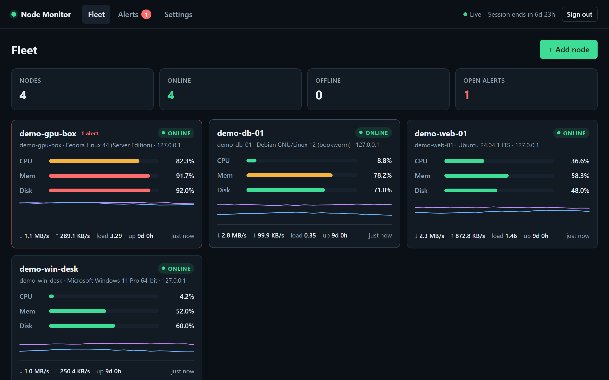
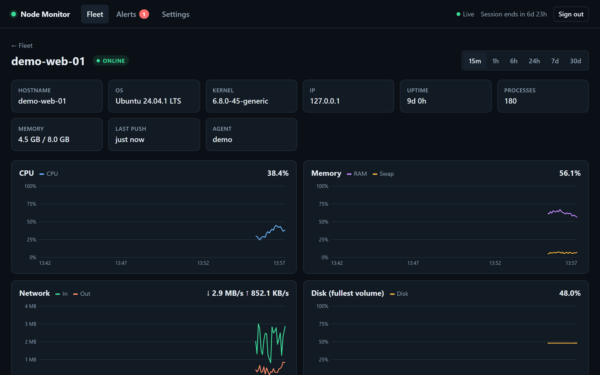

# Node Monitor

Watch all your servers from one dashboard, even when they are on different networks and cannot reach each other.

One machine runs the **hub**. Every other server runs a tiny **agent** from cron (Linux) or Task Scheduler (Windows) that pushes its CPU, memory, disk and network usage to the hub every 5 seconds, over your LAN or [Tailscale](https://tailscale.com). The hub keeps history in Postgres (TimescaleDB when available), raises alerts, and serves a live web UI.



```
 web-01 (Linux, cron)   ──┐
 db-01  (Linux, cron)   ──┼── HTTPS/HTTP POST every 5 s ──►  hub  ──►  Postgres / TimescaleDB
 desk   (Windows, task) ──┘     (per-node token)              │
                                                              └──►  web UI (live, token sign-in)
```

## Why this exists

- **Push, not pull.** Agents connect out to the hub. Servers can sit behind NAT or CGNAT, with no open ports and no SSH from the hub.
- **No daemon on your servers.** Cron starts the agent once a minute. It samples 12 times, 5 s apart, then exits. It needs only `bash`, `curl` and `awk` on Linux, or built-in PowerShell on Windows.
- **Small.** The hub is under 900 lines of plain Node.js with one dependency (`pg`). The UI is plain HTML/CSS/JS. No build step, frontend framework or Redis.
- **Uses the Postgres you already have.** All tables live in their own schema. TimescaleDB is used automatically if installed.

## Try it in 2 minutes (Docker)

Needs Docker with Compose. This starts the hub and a TimescaleDB container.

```sh
git clone https://github.com/amirulaliffcherahim/node-monitor.git
cd node-monitor
docker compose up -d
docker compose logs hub          # copy the "nmui_..." access token printed once
```

Open <http://localhost:8787> and paste the token.

The fleet is empty until an agent connects. To see the dashboard with fake data first, start the demo feeder:

```sh
docker compose exec hub node scripts/demo.mjs     # Ctrl+C to stop
```

It creates four `demo-*` nodes and pushes realistic metrics every 5 s. Remove them afterwards with `docker compose exec hub node scripts/demo.mjs --remove`.

> Before you leave it running, set a real database password: `POSTGRES_PASSWORD=... docker compose up -d` (or put it in a `.env` file next to `docker-compose.yml`).

## Monitor your first real server

1. In the UI, click **+ Add node** and give it a name.
2. Copy the install command it shows and run it on that server.

   **Linux** (as root; needs `curl`, `bash`, `awk` and cron):

   ```sh
   curl -fsSL http://HUB:8787/install.sh | sudo sh -s -- --url http://HUB:8787 --token nmn_...
   ```

   **Windows** (elevated PowerShell 5.1+):

   ```powershell
   irm http://HUB:8787/install.ps1 -OutFile $env:TEMP\nm-install.ps1; powershell -NoProfile -ExecutionPolicy Bypass -File $env:TEMP\nm-install.ps1 -Url http://HUB:8787 -Token nmn_...
   ```

3. The installer does a test push and reports `HTTP 204` on success. The node turns **online** in the UI within a minute.

`HUB` must be an address that the server can reach: a LAN IP, a Tailscale IP or MagicDNS name, or a public hostname. Set `PUBLIC_URL` on the hub so the UI builds the command with the correct address (`PUBLIC_URL=http://my-hub:8787 docker compose up -d`).

| | Linux | Windows |
|---|---|---|
| Agent | `/usr/local/bin/nodemon-agent` | `C:\ProgramData\nodemon\nodemon-agent.ps1` |
| Config (holds the token) | `/etc/nodemon-agent.conf`, mode 0600 | `C:\ProgramData\nodemon\agent.json`, SYSTEM + Administrators only |
| Schedule | `/etc/cron.d/nodemon-agent`, every minute | Scheduled task `nodemon-agent` (SYSTEM), every minute |
| Uninstall | `... \| sudo sh -s -- --uninstall` | `... nm-install.ps1 -Uninstall` |
| Test once | `sudo nodemon-agent --once` | `powershell -File C:\ProgramData\nodemon\nodemon-agent.ps1 -Once` |

## Features



- **Fleet view:** status, CPU, memory, disk, network, load and uptime per server, with sparklines. Problem nodes sort to the top.
- **Node view:** charts for 15 m, 1 h, 6 h, 24 h, 7 d and 30 d, a per-volume disk table, and alert history.
- **Live updates** over Server-Sent Events. No page refresh needed.
- **Alerts** on CPU, memory, disk (fullest volume), swap and offline nodes. Each has a threshold and a "sustained for" time. Alerts resolve on their own when the condition clears. An optional webhook posts to Discord, Slack, ntfy, n8n and similar.
- **Access tokens:** never expire, can be revoked at any time, and you can create one per person or device.
- **Retention:** 30 days by default. TimescaleDB compresses and drops old chunks; plain Postgres is pruned hourly by the hub.

### What the agent sends

CPU %, 1-minute load (Linux), memory, swap, used/total for every real disk volume, network bytes/s (loopback, Docker, VPN and Tailscale interfaces excluded), process count, uptime, hostname, OS and kernel. Nothing else: no process names, no logs, no files.

## Run without Docker (existing Postgres)

Needs Node.js 22.9+ and Postgres 13+.

```sh
git clone https://github.com/amirulaliffcherahim/node-monitor.git
cd node-monitor
npm install --omit=dev
cp .env.example .env            # Windows: copy .env.example .env
# edit .env: DATABASE_URL and PUBLIC_URL
npm start
```

The first start prints the bootstrap access token. A dedicated database and role keep the hub away from your other data:

```sql
CREATE ROLE nodemon LOGIN PASSWORD 'change-me';
CREATE DATABASE nodemon OWNER nodemon;
\c nodemon
CREATE EXTENSION IF NOT EXISTS timescaledb;   -- optional; needs the extension installed
```

Keep it running with pm2, systemd or a Windows scheduled task:

```sh
pm2 start src/server.js --name node-monitor --node-args="--env-file=.env" && pm2 save
```

### TimescaleDB notes

With the extension available, `metrics` becomes a hypertable with 1-day chunks. Compression (after 2 days) and the retention policy need the Timescale License (TSL) build, which the official `timescale/timescaledb` Docker image includes. On Apache-only builds, such as many distro packages, the hub logs that those policies were skipped and prunes old rows itself. At one sample every 5 s, each node adds about 17,000 rows per day. Plain Postgres handles that comfortably for a small fleet.

## Signing in

The web UI has no usernames or passwords. Access is by **access token** only.

- **Tokens never expire.** Create them in **Settings → Access tokens**. Each one is shown once and stored only as a SHA-256 hash.
- **Sessions last 7 days.** After signing in, the browser stays signed in for `SESSION_DAYS` (default 7), counted from sign-in and not extended by activity. After that, enter the token again.
- **Revoking a token** signs out every browser that used it immediately, including live streams.
- Sign-in allows 10 failed attempts per IP per 15 minutes.

Lost every token? Run this on the hub:

```sh
npm run token -- create "recovery"                      # bare metal
docker compose exec hub node scripts/token.mjs create recovery   # Docker
npm run token -- list
npm run token -- revoke 3
```

## Configuration

Set these as environment variables or in `.env`.

| Variable | Default | Purpose |
|---|---|---|
| `DATABASE_URL` | `postgres://postgres@127.0.0.1:5432/postgres` | Postgres connection |
| `DB_SCHEMA` | `nodemon` | Schema for all hub tables |
| `DATABASE_SSL` | off | `1` to connect over TLS |
| `TIMESCALE` | auto | `off` to force a plain table |
| `HOST` / `PORT` | `0.0.0.0` / `8787` | Listen address. Bind to a Tailscale or LAN IP to limit exposure |
| `PUBLIC_URL` | request host | Hub address used in the install commands |
| `SESSION_DAYS` | `7` | Days before the token must be re-entered |
| `COOKIE_SECURE` | off | `1` when served over HTTPS |
| `RETENTION_DAYS` | `30` | History kept |
| `OFFLINE_AFTER_SEC` | `20` | Initial offline threshold (editable in the UI) |
| `ALERT_WEBHOOK_URL` | none | POSTs `{"content": "...", "text": "..."}` on alert open and resolve |

Agent settings live in its config file: `INTERVAL` (default 5 s) and `SAMPLES` per run (default 12). Keep `INTERVAL × SAMPLES` at or under 60 so runs do not overlap. A lock skips a run if the previous one is still going.

## Security

- **Encrypt the transport.** Tailscale or WireGuard already does this. On a plain LAN or the internet, put the hub behind HTTPS (`tailscale serve`, Caddy, nginx) and set `COOKIE_SECURE=1`. Node tokens are sent as `Authorization: Bearer` headers.
- **Untrusted agent input.** The hub type-checks and clamps every value, caps request bodies at 64 KB, and accepts at most one push per node every 2 s.
- **Web UI hardening:** `HttpOnly` + `SameSite=Strict` cookie, cross-origin writes rejected, strict Content-Security-Policy with no inline script, and all agent-supplied text rendered as text, never HTML.
- **Rotate a node token** in **Settings → Nodes**. The old agent stops at once (it exits on `401`). Reinstall it with the new command.
- Limit who can reach port 8787, for example with a firewall rule allowing only your Tailscale interface.

Found a vulnerability? Please open a private security advisory on GitHub instead of a public issue.

## Troubleshooting

| Symptom | Check |
|---|---|
| Installer says the test push failed | From the server, run `curl -v http://HUB:8787/install.sh`. If it times out, a firewall or the wrong `HUB` address is the cause. |
| Node stays **pending** | Cron is not running (`systemctl status crond` or `cron`), or the scheduled task is disabled. Run the agent with `--once` / `-Once` to see the HTTP code. |
| `HTTP 401` from the agent | The token was rotated or the node was deleted. Reinstall with the command from **Add node**. |
| Node flaps online/offline | The offline threshold is too tight for that link. Raise it in **Settings → Alert rules**. |
| Signed out after a week | Expected. Sessions last `SESSION_DAYS`. Enter your token again. |

## Development

```sh
npm install
npm test                  # unit tests (node:test)
npm start                 # needs DATABASE_URL
npm run demo              # fake nodes against the running hub
```

Layout:

```
src/      hub: HTTP server, auth, alerts, Postgres schema
public/   web UI: plain HTML/CSS/JS, no build step
agent/    Linux and Windows agents + installers (served by the hub)
scripts/  token recovery CLI, demo data
```

Issues and pull requests are welcome. Please keep the hub dependency-light and the agents free of runtime installs.

## License

[MIT](LICENSE)
